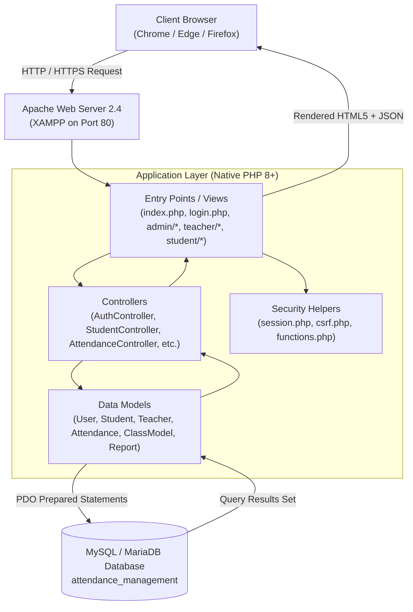
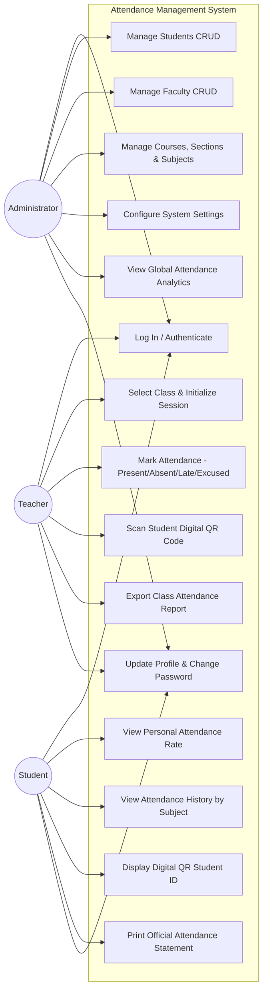
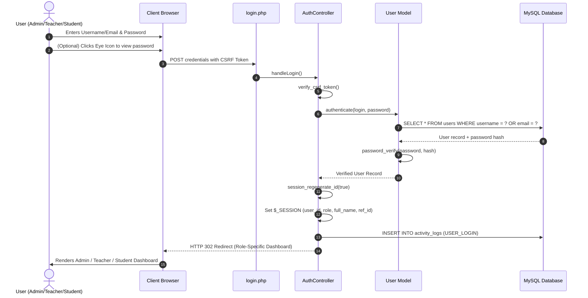
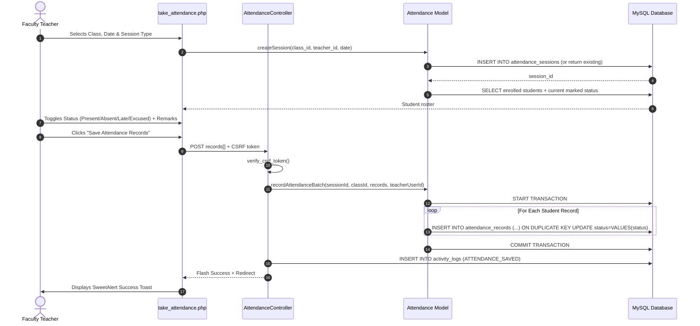
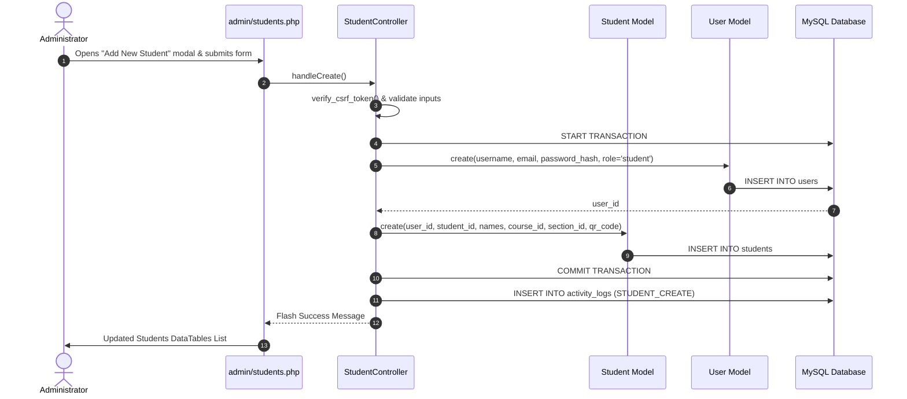
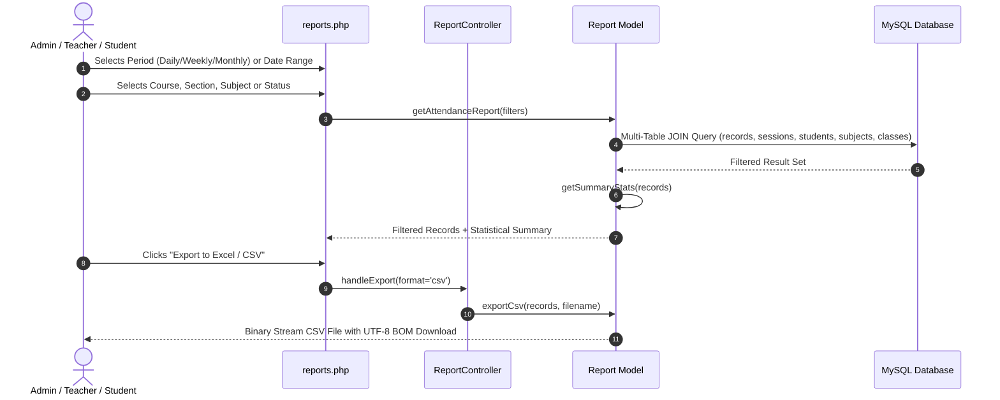
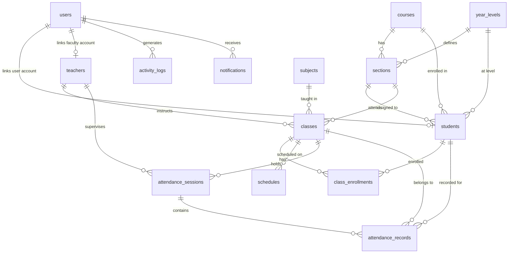

# ATTENDANCE MANAGEMENT SYSTEM (AMS)
### Enterprise-Grade Educational Attendance Tracking & Analytics Platform

[](https://php.net)
[](https://mysql.com)
[](https://getbootstrap.com)
[](#security-architecture)

---

## TABLE OF CONTENTS
- [Quick Start Guide](#quick-start-guide)
- [Default Login Credentials](#default-login-credentials)
- [CHAPTER 1 – SYSTEM OVERVIEW](#chapter-1--system-overview)
  - [1.1 System Overview](#11-system-overview)
  - [1.2 Target Users](#12-target-users)
  - [1.3 Scope of the System](#13-scope-of-the-system)
  - [1.4 Technology Stack](#14-technology-stack)
- [CHAPTER 2 – SYSTEM ARCHITECTURE](#chapter-2--system-architecture)
  - [2.1 High-Level Architecture Diagram](#21-high-level-architecture-diagram)
  - [2.2 Detailed Architecture Discussion](#22-detailed-architecture-discussion)
  - [2.3 Deployment and Installation Setup](#23-deployment-and-installation-setup)
- [CHAPTER 3 – UML (USE CASE MODELING)](#chapter-3--uml-use-case-modeling)
  - [3.1 System Use Case Diagram](#31-system-use-case-diagram)
  - [3.2 Use Case Descriptions](#32-use-case-descriptions)
- [CHAPTER 4 – SEQUENCE DIAGRAMS](#chapter-4--sequence-diagrams)
  - [4.1 User Authentication Sequence](#41-user-authentication-sequence)
  - [4.2 Attendance Recording & QR Scan Sequence](#42-attendance-recording--qr-scan-sequence)
  - [4.3 Student Management Sequence](#43-student-management-sequence)
  - [4.4 Report Generation & Export Sequence](#44-report-generation--export-sequence)
- [CHAPTER 5 – DATABASE DESIGN](#chapter-5--database-design)
  - [5.1 Entity Relationship Diagram (ERD)](#51-entity-relationship-diagram-erd)
  - [5.2 Database Tables & Data Dictionary](#52-database-tables--data-dictionary)
  - [5.3 Relationship Descriptions](#53-relationship-descriptions)
- [CHAPTER 6 – SQL IMPLEMENTATION OF CRUD OPERATIONS](#chapter-6--sql-implementation-of-crud-operations)
  - [6.1 CREATE Operations](#61-create-operations)
  - [6.2 READ Operations](#62-read-operations)
  - [6.3 UPDATE Operations](#63-update-operations)
  - [6.4 DELETE Operations](#64-delete-operations)
- [SYSTEM USAGE & USER MANUAL](#system-usage--user-manual)
- [LICENSE & AUTHOR](#license--author)

---

## QUICK START GUIDE

### Prerequisites
1. **XAMPP for Windows** (with Apache and MySQL / MariaDB installed and started).
2. **PHP 8.0+** (PHP 8.2 recommended).
3. **Web Browser**: Chrome, Edge, Firefox, or Safari.

### Installation Steps
1. **Extract or Place Workspace Files**:
   Ensure the project folder is placed in your XAMPP web root:
   ```text
   C:\xampp\htdocs\attendance_management_system\
   ```
   *(Note: The system also includes junction compatibility for `http://localhost/attendance_management/`).*

2. **Database Import**:
   - Open **phpMyAdmin** at `http://localhost/phpmyadmin/` or open your MySQL Command Line.
   - Run the provided `database.sql` script:
     ```cmd
     mysql -u root < C:\xampp\htdocs\attendance_management_system\database.sql
     ```
   - This automatically creates the `attendance_management` database with all 16 tables, constraints, foreign keys, and seed records.

3. **Open the Application**:
   Navigate your browser to:
   ```text
   http://localhost/attendance_management_system/
   ```
   or
   ```text
   http://localhost/attendance_management/
   ```

---

## DEFAULT LOGIN CREDENTIALS

The database seed includes pre-configured accounts for all three user roles:

| Role | Username | Email | Password | Access Level |
| :--- | :--- | :--- | :--- | :--- |
| **Administrator** | `admin` | `admin@attendance.com` | `admin123` | Full System Control |
| **Faculty Teacher** | `teacher` | `teacher@attendance.com` | `teacher123` | Class Attendance & Rosters |
| **Student** | `student` | `student@attendance.com` | `student123` | Personal Attendance & QR Card |

*(Tip: On the `login.php` screen, click the **Quick Demo Login** buttons to auto-populate credentials with one click!)*

---

## CHAPTER 1 – SYSTEM OVERVIEW

### 1.1 System Overview
The **Attendance Management System (AMS)** is a web-based platform designed for colleges, universities, and secondary institutions. It modernizes manual paper-based attendance registers into a secure, database-driven solution that provides:
- Instant attendance session creation by subject and class section.
- One-click batch marking (`Mark All Present`, `Mark All Absent`, `Mark All Late`).
- Digital QR Code scanning via device camera or barcode scanner.
- Interactive Chart.js analytics for institutional and class-level compliance monitoring.
- Export options in CSV, Excel, Print-ready PDF, and DataTables format.

### 1.2 Target Users
1. **School Administrators**: Academic deans, registrar officers, and IT personnel who manage curriculum, courses, sections, user accounts, and institutional compliance audits.
2. **Faculty Members / Teachers**: Lecturers and lab instructors responsible for taking daily attendance, managing class rosters, and verifying absences.
3. **Students**: Enrolled learners who track their personal attendance rates, download verification certificates, and display their encrypted digital QR ID badges.

### 1.3 Scope of the System
- **Curriculum & Academic Structure**: Courses, Year Levels, Sections, Subjects, and Class Offerings.
- **Timetabling**: Class day, time slots, and room allocations.
- **Attendance Lifecycle**: Session opening, real-time presence recording (Present, Absent, Late, Excused), duplicate prevention, and authorized record corrections.
- **Security & Access Control**: Role-Based Access Control (RBAC), bcrypt password hashing, CSRF tokens on all state-altering forms, XSS sanitization, and parameterized PDO queries.

### 1.4 Technology Stack
- **Frontend**: HTML5, CSS3, JavaScript (ES6+), Bootstrap 5.3, Bootstrap Icons 1.11, DataTables 1.13, Chart.js 4.4, SweetAlert2 11, and HTML5-QRCode 2.3.
- **Backend**: Native PHP 8.2+ (MVC-inspired architecture with Controllers and Models).
- **Database**: MySQL 8.0+ / MariaDB 10.4+ using PDO (PHP Data Objects) with prepared statements.
- **Development Environment**: XAMPP for Windows, VS Code, Apache 2.4.

---

## CHAPTER 2 – SYSTEM ARCHITECTURE

### 2.1 High-Level Architecture Diagram



### 2.2 Detailed Architecture Discussion
The system uses a clean, maintainable MVC (Model-View-Controller) structure:
1. **View Layer (`/views`, `/admin`, `/teacher`, `/student`)**: Renders modern responsive user interfaces using Bootstrap 5 and the Dark Navy / Purple design system.
2. **Controller Layer (`/controllers`)**: Validates CSRF tokens, sanitizes inputs, enforces authorization via `require_role()`, and orchestrates model operations.
3. **Model Layer (`/models`)**: Encapsulates all SQL logic using PDO prepared statements with parameter binding to prevent SQL injection.
4. **Security Infrastructure (`/includes`)**:
   - `csrf.php`: Generates cryptographically secure random tokens (`random_bytes(32)`) and verifies tokens on all POST submissions.
   - `session.php`: Enforces secure cookie attributes (`HttpOnly`, `SameSite=Lax`), session regeneration upon login, and role-based route protection.
   - `functions.php`: Provides centralized XSS protection via `e()` (`htmlspecialchars`), activity logging, and attendance calculation algorithms.

### 2.3 Deployment and Installation Setup
- **Apache Virtual Host / Directory Configuration**: Handled in `config/config.php` with automatic dynamic base URL resolution so the project functions regardless of subdirectory naming.
- **Directory Permissions**: The `/uploads/avatars/` and `/reports/exports/` folders require write permissions for file uploads and export storage.

---

## CHAPTER 3 – UML (USE CASE MODELING)

### 3.1 System Use Case Diagram



### 3.2 Use Case Descriptions

#### Use Case UC-01: Take Class Attendance
- **Primary Actor**: Faculty Teacher.
- **Preconditions**: Teacher is authenticated; classes and student enrollments exist.
- **Main Flow**:
  1. Teacher navigates to `teacher/take_attendance.php`.
  2. Teacher selects Class, Subject, Date, and Session Type.
  3. System initializes session in `attendance_sessions` (or retrieves open session) and lists all enrolled students.
  4. Teacher uses quick action ("Mark All Present") or toggles individual student statuses (`PRESENT`, `ABSENT`, `LATE`, `EXCUSED`).
  5. Teacher submits the form.
  6. System validates CSRF, commits batch records using `INSERT ... ON DUPLICATE KEY UPDATE`, logs activity, and displays a success notification.
- **Postconditions**: Attendance records are saved with instructor ID and submission timestamp.

#### Use Case UC-02: QR Code Attendance Check-in
- **Primary Actor**: Faculty Teacher / Student.
- **Main Flow**:
  1. Teacher opens QR Scanner modal on `teacher/take_attendance.php`.
  2. Student displays their encrypted Digital QR ID from `student/dashboard.php`.
  3. Camera scans the QR code; client script dispatches an asynchronous POST request.
  4. Backend verifies student enrollment in the active class session.
  5. System records attendance as `PRESENT`, logs timestamp, sends student in-app notification, and returns JSON success response.
  6. Frontend flashes SweetAlert success toast and updates the table row in real time.

---

## CHAPTER 4 – SEQUENCE DIAGRAMS

### 4.1 User Authentication Sequence



### 4.2 Attendance Recording Sequence



### 4.3 Student Management Sequence



### 4.4 Report Generation Sequence



---

## CHAPTER 5 – DATABASE DESIGN

### 5.1 Entity Relationship Diagram (ERD)



### 5.2 Database Tables & Data Dictionary

#### 1. Table: `users`
| Column | Type | Nullable | Key | Description |
| :--- | :--- | :--- | :--- | :--- |
| `id` | INT AUTO_INCREMENT | No | PK | Primary Identifier |
| `username` | VARCHAR(50) | No | UK | Login Username |
| `email` | VARCHAR(100) | No | UK | User Email Address |
| `password` | VARCHAR(255) | No | | Bcrypt Hashed Password |
| `role` | ENUM('admin','teacher','student') | No | IDX | Access Role |
| `full_name` | VARCHAR(100) | No | | Display Name |
| `avatar` | VARCHAR(255) | Yes | | Uploaded Avatar Filename |
| `status` | ENUM('active','inactive','pending')| No | IDX | Account Status |
| `last_login` | DATETIME | Yes | | Timestamp of last authentication |
| `created_at` | TIMESTAMP | No | | Account creation timestamp |

#### 2. Table: `students`
| Column | Type | Nullable | Key | Description |
| :--- | :--- | :--- | :--- | :--- |
| `id` | INT AUTO_INCREMENT | No | PK | Primary Student ID |
| `user_id` | INT | Yes | FK | Linked `users.id` |
| `student_id`| VARCHAR(30) | No | UK | Institutional Student ID |
| `first_name`| VARCHAR(50) | No | | First Name |
| `last_name` | VARCHAR(50) | No | | Last Name |
| `email` | VARCHAR(100) | No | UK | Contact Email |
| `gender` | ENUM('Male','Female','Other') | No | | Gender |
| `course_id` | INT | No | FK | Enrolled Course |
| `year_level_id`| INT | No | FK | Academic Year Level |
| `section_id`| INT | No | FK | Cohort Section |
| `contact_number`| VARCHAR(20) | Yes | | Telephone / Mobile |
| `qr_code` | VARCHAR(255) | Yes | | QR Badge Token |
| `status` | ENUM('active','inactive',...)| No | | Academic Status |

#### 3. Table: `teachers`
| Column | Type | Nullable | Key | Description |
| :--- | :--- | :--- | :--- | :--- |
| `id` | INT AUTO_INCREMENT | No | PK | Primary Faculty ID |
| `user_id` | INT | Yes | FK | Linked `users.id` |
| `teacher_id`| VARCHAR(30) | No | UK | Institutional Faculty ID |
| `first_name`| VARCHAR(50) | No | | Faculty First Name |
| `last_name` | VARCHAR(50) | No | | Faculty Last Name |
| `email` | VARCHAR(100) | No | UK | Professional Email |
| `department`| VARCHAR(100) | Yes | | Academic Department |
| `qualification`| VARCHAR(100)| Yes | | Degree Qualification |
| `status` | ENUM('active','inactive') | No | | Employment Status |

#### 4. Table: `classes`
| Column | Type | Nullable | Key | Description |
| :--- | :--- | :--- | :--- | :--- |
| `id` | INT AUTO_INCREMENT | No | PK | Primary Class Offering ID |
| `class_code`| VARCHAR(50) | No | UK | Course Class Code |
| `subject_id`| INT | No | FK | Linked `subjects.id` |
| `section_id`| INT | No | FK | Linked `sections.id` |
| `teacher_id`| INT | No | FK | Assigned Faculty `teachers.id` |
| `academic_year`| VARCHAR(20)| Yes | | Term (e.g. 2025-2026) |
| `semester` | VARCHAR(20) | Yes | | Active Semester |
| `room` | VARCHAR(50) | Yes | | Assigned Lecture Room |

#### 5. Table: `attendance_sessions`
| Column | Type | Nullable | Key | Description |
| :--- | :--- | :--- | :--- | :--- |
| `id` | INT AUTO_INCREMENT | No | PK | Primary Session ID |
| `class_id` | INT | No | FK | Associated Class |
| `teacher_id`| INT | No | FK | Faculty Member |
| `session_date`| DATE | No | IDX | Date of Class Meeting |
| `session_type`| ENUM('Regular Lecture',...)| No| | Type of Session |
| `status` | ENUM('open','closed') | No | | Session Lock Status |

#### 6. Table: `attendance_records`
| Column | Type | Nullable | Key | Description |
| :--- | :--- | :--- | :--- | :--- |
| `id` | INT AUTO_INCREMENT | No | PK | Primary Record ID |
| `session_id`| INT | No | FK | Linked `attendance_sessions.id` |
| `student_id`| INT | No | FK | Attending `students.id` |
| `class_id` | INT | No | FK | Associated `classes.id` |
| `status` | ENUM('PRESENT','ABSENT','LATE','EXCUSED')| No | IDX | Presence Status |
| `remarks` | VARCHAR(255) | Yes | | Tardy / Excuse Notes |
| `marked_by` | INT | Yes | FK | Recorder `users.id` |
| `marked_at` | TIMESTAMP | No | | Exact Timestamp Logged |

### 5.3 Relationship Descriptions
- **Duplicate Prevention**: `attendance_records` includes a composite unique index:
  ```sql
  UNIQUE KEY unique_session_student (session_id, student_id)
  ```
  This ensures a student can never have duplicate attendance records for the same session.
- **Session Uniqueness**: `attendance_sessions` includes:
  ```sql
  UNIQUE KEY unique_class_session (class_id, session_date, session_type)
  ```
  This prevents duplicate session creation for the same class and meeting type on any single day.
- **Referential Integrity**: Cascading updates and deletes (`ON DELETE CASCADE`) keep database relationships synchronized.

---

## CHAPTER 6 – SQL IMPLEMENTATION OF CRUD OPERATIONS

### 6.1 CREATE Operations

#### Create a New Student & Link User Account
```sql
-- 1. Create User Authentication Record
INSERT INTO users (username, email, password, role, full_name, avatar, status)
VALUES ('lbennett', 'liam.bennett@school.edu', '$2y$10$...', 'student', 'Liam Bennett', 'default-avatar.png', 'active');

-- 2. Create Student Profile Record
INSERT INTO students (
    user_id, student_id, first_name, last_name, email,
    gender, birth_date, course_id, year_level_id, section_id,
    contact_number, qr_code, status
) VALUES (
    LAST_INSERT_ID(), 'STD-2025-010', 'Liam', 'Bennett', 'liam.bennett@school.edu',
    'Male', '2005-03-14', 1, 1, 1,
    '+1 (555) 234-5678', 'QR_STD-2025-010', 'active'
);
```

#### Record Attendance Batch (with Duplicate Prevention)
```sql
INSERT INTO attendance_records (session_id, student_id, class_id, status, remarks, marked_by, marked_at)
VALUES (5, 1, 1, 'PRESENT', 'On time via QR Scan', 2, NOW())
ON DUPLICATE KEY UPDATE 
    status = VALUES(status),
    remarks = VALUES(remarks),
    marked_by = VALUES(marked_by),
    updated_at = NOW();
```

### 6.2 READ Operations

#### Read Student Attendance Rate & History
```sql
SELECT 
    COUNT(*) as total_records,
    SUM(CASE WHEN status = 'PRESENT' THEN 1 ELSE 0 END) as present_count,
    SUM(CASE WHEN status = 'ABSENT' THEN 1 ELSE 0 END) as absent_count,
    SUM(CASE WHEN status = 'LATE' THEN 1 ELSE 0 END) as late_count,
    SUM(CASE WHEN status = 'EXCUSED' THEN 1 ELSE 0 END) as excused_count
FROM attendance_records
WHERE student_id = 1;
```

#### Multi-Table Filtered Attendance Audit Report
```sql
SELECT 
    ar.id, s.session_date, s.session_type,
    st.student_id, CONCAT(st.first_name, ' ', st.last_name) as student_name,
    sub.subject_code, sub.subject_name,
    c.class_code, sec.section_name,
    CONCAT(t.first_name, ' ', t.last_name) as teacher_name,
    ar.status, ar.remarks, ar.marked_at
FROM attendance_records ar
JOIN attendance_sessions s ON ar.session_id = s.id
JOIN students st ON ar.student_id = st.id
JOIN classes c ON ar.class_id = c.id
JOIN subjects sub ON c.subject_id = sub.id
JOIN sections sec ON c.section_id = sec.id
JOIN teachers t ON c.teacher_id = t.id
WHERE s.session_date BETWEEN '2026-11-01' AND '2026-11-30'
ORDER BY s.session_date DESC, st.last_name ASC;
```

### 6.3 UPDATE Operations

#### Authorized Attendance Correction
```sql
UPDATE attendance_records 
SET status = 'EXCUSED', 
    remarks = 'Medical certificate slip submitted to registrar',
    marked_by = 1,
    updated_at = NOW()
WHERE id = 15;
```

#### Update User Password
```sql
UPDATE users 
SET password = '$2y$10$t5TAe60At/TE8x/OJyxcQO39GE9rteKoVZP7RyrCn7SKz5Z6kCxeO', 
    updated_at = NOW() 
WHERE id = 1;
```

### 6.4 DELETE Operations

#### Delete Class Offering
```sql
-- Cascades and removes associated schedules, enrollments, and sessions cleanly
DELETE FROM classes WHERE id = 4;
```

#### Delete Student Record
```sql
DELETE FROM students WHERE id = 6;
```

---

## CHAPTER 7 – INDIVIDUAL STUDENT ATTENDANCE REORGANIZATION

### 7.1 Architecture Overview
The system features an **Individual Student Attendance Architecture** that prevents cross-student record mingling:
1. **Isolated Student Profiles**: Every student has a dedicated profile and attendance view (`admin/attendance.php?student_id=XX` and `teacher/students.php?student_id=XX`).
2. **Student Information**: Each profile displays the Student Name, Student ID, Grade Level (Year Level), Section, Course/Program, Contact, and Digital QR Badge.
3. **Time Tracking**: Every attendance record stores and displays `time_in` and `time_out` alongside the status (`PRESENT`, `ABSENT`, `LATE`, `EXCUSED`).
4. **Attendance History with Quick Filters**: Users can toggle between **Daily (Today)**, **Weekly (This Week)**, and **Monthly (This Month)** views with one click, or specify exact Date Ranges.
5. **Separate Summary & Automated Percentage Calculation**: Statistics (Total Days Present, Total Days Absent, Total Days Late, Total Days Excused, and Attendance Percentage) are calculated dynamically per student.
6. **Data Integrity Guarantee**: All queries link strictly to `student_id`. Modifying or updating one student's attendance record is isolated via primary key `attendance_records.id` and never alters any other student's logs.

### 7.2 How to Access Individual Student Attendance

#### A. As Administrator
1. Go to **Attendance Records** (`admin/attendance.php`) or **Students** (`admin/students.php`).
2. Students are presented in modern cards and rows with summary metrics.
3. Click the **View Attendance** button on any student.
4. The system opens the student's individual attendance profile displaying:
   - Personal information (Name, ID, Grade Level, Section, Program, Contact).
   - Real-time attendance rate (%) and Days Present/Absent/Late/Excused.
   - Quick filters for Daily, Weekly, and Monthly attendance.
   - Separate attendance table showing Date, Time In, Time Out, Status, Remarks, and Instructor.
   - Tools to edit records, add individual records, or export student CSV.

#### B. As Faculty Teacher
1. Go to **Enrolled Students** (`teacher/students.php`).
2. Browse your students across all assigned classes or filter by cohort.
3. Click **View Attendance** next to any student to view their isolated attendance history.
4. View punch-in/out times, filter by Daily/Weekly/Monthly, or add an authorized individual attendance entry.

#### C. As Student
1. Log in as a student (`student/dashboard.php` or `student/my_attendance.php`).
2. View your individual dashboard showing your personalized attendance percentage, Present/Absent/Late counts, Time In, and Time Out.
3. Filter attendance history by Day, Week, or Month.
4. Strict security guarantees students can only view their own attendance records.

---

## SYSTEM USAGE & USER MANUAL

### 1. How to Test Password Eye Icon
1. Go to `http://localhost/attendance_management_system/login.php`.
2. Type any text into the Password field.
3. Click the **Eye icon** button on the right side of the password field:
   - The password text is revealed.
   - The icon toggles to a crossed eye (`bi-eye-slash`).
4. Click it again:
   - The password text is masked as dots.
   - The icon toggles back to `bi-eye`.

### 2. How to Record Attendance as Teacher
1. Log in with `teacher` / `teacher123`.
2. On the Teacher Dashboard, click **Take Attendance Now** (or choose **Take Attendance** from the sidebar).
3. Select your desired Class and Date (defaults to today).
4. Click **Mark All Present** to quickly mark everyone, or toggle individual students to **Absent**, **Late**, or **Excused**.
5. Click **Save Attendance Records**. A success toast confirms your submission.

### 3. How to Use QR Code Check-in
1. Log in as `student` / `student123` on one tab or your mobile phone to view your Digital Student ID QR badge.
2. Log in as `teacher` on another tab and go to **Take Attendance**.
3. Click **Open QR Scanner**.
4. Allow camera permissions (or type the Student ID `STD-2024-001` into the manual barcode box).
5. The student is verified and checked in as **PRESENT** in under one second.

### 4. How to Generate Reports & Export
1. Log in as `admin` and go to **Attendance Reports** (`admin/reports.php`).
2. Filter by period (Daily, Weekly, Monthly) or select specific Date Ranges, Courses, Sections, or Subjects.
3. Click **Generate Report**.
4. Click **Print Report** to print or save as PDF.
5. Click **Export to Excel / CSV** to download a CSV file formatted with UTF-8 BOM encoding.

---

## LICENSE & AUTHOR

Developed by the **Google DeepMind Team** as a reference implementation for **Attendance Management Systems**.  
Built with Native PHP 8+, PDO MySQL, and Bootstrap 5.
